  

 

# Sebastián Piñango
### Full-Stack Developer | CRM & ERP Frontend | DevOps

  Specialized in <b>Enterprise CRM / ERPs Frontend</b> using <b>Svelte 5</b>, <b>Flutter</b>, and <b>Tailwind CSS</b>,
   
  backed by automated <b>DevOps pipelines</b> (AWS, Docker, CI/CD), robust <b>Go &amp; Laravel services</b>, and <b>IoT telemetry</b>.

---

### Tech Stack & Arsenal

#### Languages

#### Frontend

#### Backend & Architecture

#### DevOps, Cloud & Deployment
[-FF8E05?style=for-the-badge&logo=amazon&logoColor=white)](https://github.com/Quimaerical)

#### Databases, IoT & Hardware

---

### Featured Public Repositories

| Repository | Stack | Description | Highlights |
| :--- | :--- | :--- | :--- |
| **[ListScan-Pro](https://github.com/Quimaerical/ListScan-Pro)** | `Flutter` `Dart` | Offline-first mobile application for grocery and shopping list organization. | Clean reactive state, local persistence, responsive UX. |
| **[Domingo-](https://github.com/Quimaerical/Domingo-)** | `Godot` `GDScript` | 2D video game developed for game jam competition. | Patijam Finalist, custom gameplay loop and physics. |
| **[Linear-Programming-Motor](https://github.com/Quimaerical/Linear-Programming-Motor)** | `Python` `NumPy` | Mathematical optimization engine implementing Simplex dictionaries and duality. | Sensitivity analysis, matrix decomposition, CLI solvers. |
| **[project-EnterFlowERP](https://github.com/Quimaerical/project-EnterFlowERP)** | `Svelte` `TypeScript` | Enterprise Resource Planning (ERP) frontend architecture. | Ergonomic dashboards, high-volume data grids, modular views. |
| **[RETEC-front](https://github.com/Quimaerical/RETEC-front)** | `TypeScript` `AI` | Software engineering monitoring and operations dashboard. | Integration with Google AIStudio for assisted insights. |
| **[c-libs-v2](https://github.com/Quimaerical/c-libs-v2)** | `C` `C++` | Core algorithmic data structures and low-level utility libraries. | Memory-efficient pointers, manual memory allocation, data structs. |
| **[Arquitectura_del_computador](https://github.com/Quimaerical/Arquitectura_del_computador)** | `C++` | Computer architecture, instruction set simulation, and hardware logic. | CPU cycle emulation, assembly parsing, register banks. |
| **[PDF-Annotator](https://github.com/Quimaerical/PDF-Annotator)** | `PHP` | Server-side document processing and annotation utility. | Dynamic document markup and byte stream manipulation. |
| **[Whatsapp-Playwright-Console-Bot](https://github.com/Quimaerical/Whatsapp-Playwright-Console-Bot)** | `Python` `Playwright` | Automated console bot for headless web orchestration and RPA. | Event-driven scheduling, selector resiliency, session handling. |

---

### Selected Production Architectures (Enterprise & Private Work)

> [!NOTE]
> Source code for these enterprise platforms is **private**, **proprietary under NDA** or **Unreleased**. High-level architectural patterns, technology stacks, and responsibilities are outlined below:

#### 1. [TIRENURSE](https://www.tirenurse.com) — Fleet IoT Telemetry Ecosystem
- **Domain:** Industrial Fleet Telemetry, Embedded Systems & Automotive IoT.
- **Architecture:** Connects custom ESP32 microcontroller firmware (C/C++) via Bluetooth Low Energy (BLE 5.0) and GPS hardware to deliver real-time tire pressure and temperature telemetry.
- **Stack & Deliverables:** Microcontroller C/C++ firmware, high-concurrency Laravel REST API service layer with MySQL, and cross-platform Flutter client live on Google Play and Apple App Store.

#### 2. [AISCRIBE / ROUNDTOPPUEO](https://apps.apple.com/us/app/roundtoppueo/id6743457816) — Generative AI Multimedia Platform
- **Domain:** AI-Powered Multimedia Processing & Adaptive Education.
- **Architecture:** Asynchronous cloud pipeline that transcribes video and audio streams into synchronized transcripts and AI-generated study decks via OpenAI Whisper and yt-dlp.
- **Stack & Deliverables:** Independent AWS cloud architecture (EC2, S3, RDS, CloudFront), Python background worker pipelines, and Flutter application published on Apple App Store.

#### 3. [AISIGN](https://aisign.ai) — Enterprise Digital Signature Mobile Suite
- **Domain:** Corporate Document Governance & Legal Signature Workflow.
- **Role & Scope:** Solely responsible for the end-to-end development of the cross-platform mobile application.
- **Architecture:** Implemented clean architecture using the decoupled repository pattern (`DioApiClient`), tactile glassmorphic UI components, dynamic XOR-obfuscated endpoint security, and automated GitHub Actions CI/CD quality gates.

#### 4. PROYECTO SÁGA — Academic & Educational Governance Platform
- **Domain:** Educational Institutional Management (CRM/ERP).
- **Architecture:** High-performance Go backend with Gin Gonic and GORM built on a strictly normalized 3NF database schema with granular Role-Based Access Control (RBAC).
- **Stack:** Go 1.22+, SQLite (local) / PostgreSQL (production), JWT auth, and modular REST handlers.

---

  

